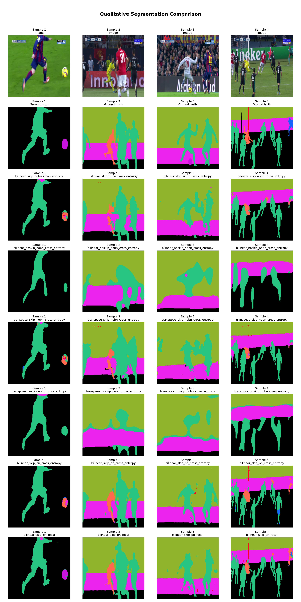
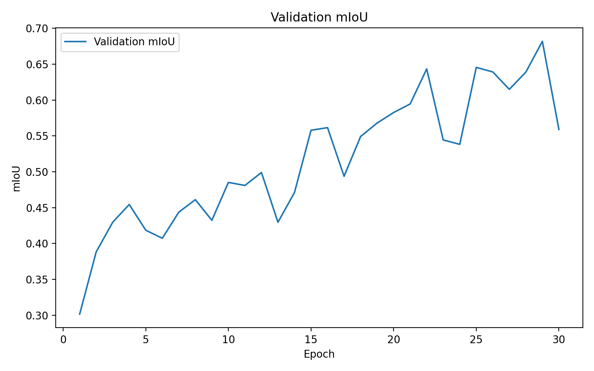
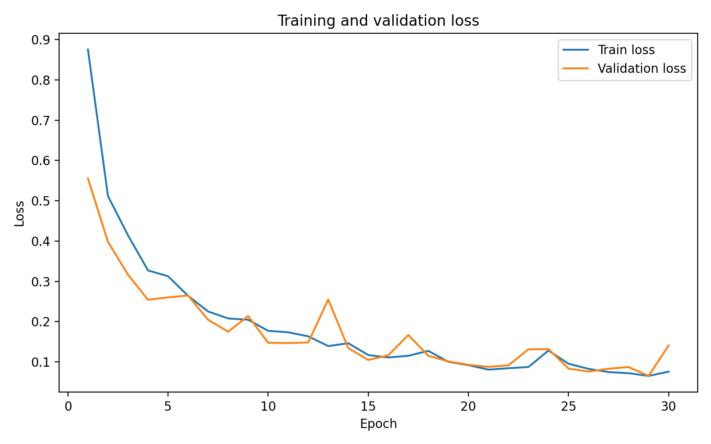
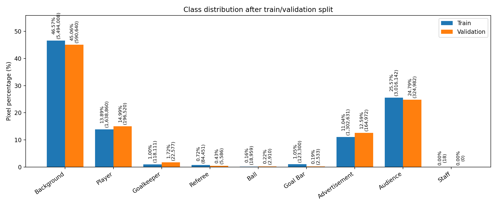
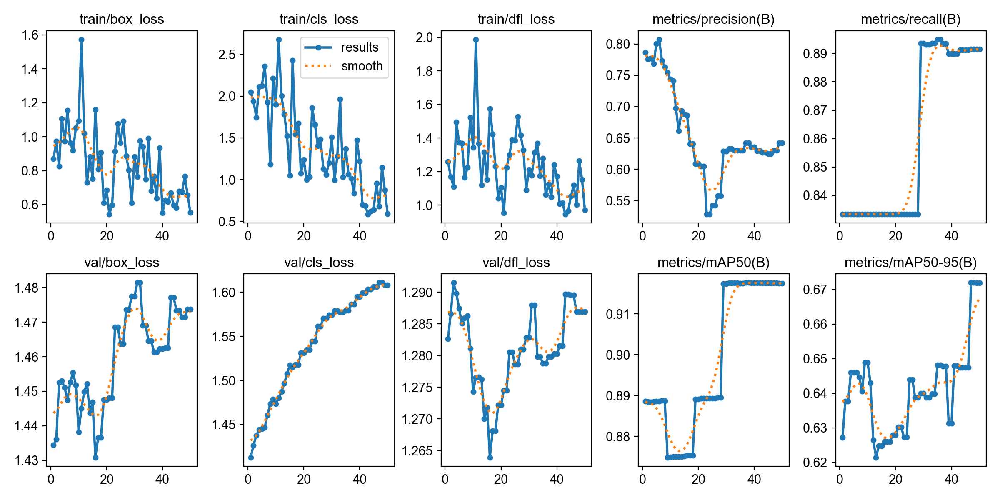
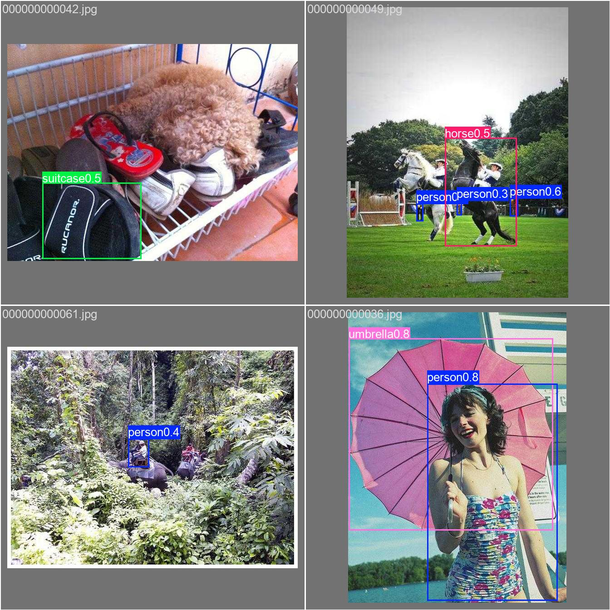

# Football Scene Segmentation with U-Net | Architecture Ablations & YOLOv8 Fine-Tuning

A deep learning course project investigating **semantic segmentation of football scenes** with a configurable **U-Net**, alongside a separate **YOLOv8n object-detection fine-tuning** experiment. The segmentation study compares decoder upsampling strategies, encoder–decoder skip connections, batch normalization, and cross-entropy versus focal loss across six training configurations.

**Highlights:** 9 unified football-scene classes · 6 U-Net experiments · best validation **mIoU 68.17%** · best pixel accuracy **95.33%** · YOLOv8n fine-tuning on COCO8.

> **Important:** The U-Net and YOLO experiments address **different tasks and datasets**: pixel-wise football semantic segmentation versus bounding-box object detection on COCO8. Their metrics are not directly comparable.

## Results at a glance

The following metrics are taken from the saved `results/evaluation/checkpoint_metrics.csv`, not recomputed for this README. Each U-Net row reports evaluation of its saved best checkpoint on the football segmentation validation split.

| U-Net configuration | Upsampling | Skip connections | Batch norm | Loss | Val. mIoU ↑ | Pixel accuracy ↑ |
| --- | --- | :---: | :---: | --- | ---: | ---: |
| Baseline 1 | Bilinear | ✓ | — | Cross-entropy | 49.23% | 92.65% |
| Baseline 2 | Bilinear | — | — | Cross-entropy | 34.23% | 84.58% |
| Baseline 3 | Transposed convolution | ✓ | — | Cross-entropy | 49.03% | 91.96% |
| Baseline 4 | Transposed convolution | — | — | Cross-entropy | 33.74% | 84.57% |
| + Batch normalization | Bilinear | ✓ | ✓ | Cross-entropy | 63.96% | 95.31% |
| **+ Focal loss (best mIoU)** | **Bilinear** | **✓** | **✓** | **Focal** | **68.17%** | **95.33%** |

**Observations:**
- **Skip connections mattered:** With bilinear upsampling and no batch normalization, mIoU rose from 34.23% without skips to 49.23% with skips (+15.00 percentage points).
- **Upsampling choice had a smaller effect** in these baseline runs: bilinear and transposed-convolution variants achieved similar mIoU when skip-connection settings matched.
- **Batch normalization improved** the bilinear, skip-connected cross-entropy model from 49.23% to 63.96% mIoU (+14.72 points).
- **Focal loss gave the strongest mIoU**, raising this figure from 63.96% to 68.17% (+4.21 points) in the batch-normalized, skip-connected configuration. These are experiment-specific observations, not guarantees of generalization.

### Qualitative segmentation comparison

The saved comparison plot shows validation images, ground-truth masks, and predictions from the six U-Net configurations:



### Training diagnostics

**Best-performing segmentation configuration — bilinear upsampling, skip connections, batch normalization, focal loss:**





**Class distribution:**



Additional plots and per-run histories are in [`results/segmentation/`](results/segmentation/); the numeric summary is in [`results/segmentation_summary.csv`](results/segmentation_summary.csv).

## Segmentation approach

### Data preparation and label harmonization

Two football segmentation datasets use different class names and RGB label encodings. The data loader pairs images with masks, maps their pixel colors to a **common nine-class taxonomy**, resizes inputs to **256 × 256**, normalizes images, and creates a seeded train/validation split (configured as **90% / 10%**).

| Class index | Unified class | Dataset 1 sources | Dataset 2 sources |
| :---: | --- | --- | --- |
| 0 | Background | Background, field | Ground |
| 1 | Player | Team 1, Team 2 | Team A, Team B |
| 2 | Goalkeeper | Goalkeeper 1, Goalkeeper 2 | Goalkeeper A, Goalkeeper B |
| 3 | Referee | Referee | Referee |
| 4 | Ball | Football | Ball |
| 5 | Goal bar | Goal bar | Goal bar |
| 6 | Advertisement | Advertisement | Advertisement |
| 7 | Audience | Spectators | Audience |
| 8 | Staff | Not labeled | Coaches and officials |

The mask mapping is implemented in [`data/data_loader.py`](data/data_loader.py). Dataset 1 requires matching image and mask filenames; Dataset 2 uses masks with the `___fuse.PNG` suffix.

### Model architecture

The custom [`UNet`](models/model.py) has a four-stage encoder, a bottleneck, and a four-stage decoder. Each convolution block consists of two **3 × 3 convolutions** followed by ReLU, optionally with batch normalization. Decoder blocks use either bilinear interpolation plus convolution or learned transposed convolutions, with optional encoder–decoder feature concatenation. A final **1 × 1 convolution** produces nine class logits at each pixel.

### Losses and evaluation

**Cross-entropy** measures the negative log probability assigned to the correct class:

$$
\mathcal{L}_{\mathrm{CE}} = -\frac{1}{N}\sum_{i=1}^{N}\log p_{i,y_i}
$$

**Focal loss** down-weights well-classified pixels to emphasize difficult predictions:

$$
\mathcal{L}_{\mathrm{focal}} = -\frac{1}{N}\sum_{i=1}^{N}(1-p_{i,y_i})^{\gamma}\log p_{i,y_i}
$$

Here, $p_{i,y_i}$ is the predicted probability of the correct class for pixel $i$, $N$ is the number of pixels in the batch, and $\gamma=2$ in the focal-loss experiment. The implementation supports optional class weights, but the supplied configuration leaves them unset.

For each class $c$, Intersection over Union is defined as:

$$
\mathrm{IoU}_c = \frac{TP_c}{TP_c+FP_c+FN_c}
$$

Mean IoU averages the per-class scores over classes present in the ground truth or predictions:

$$
\mathrm{mIoU} = \frac{1}{|\mathcal{C}_{\mathrm{valid}}|}\sum_{c\in\mathcal{C}_{\mathrm{valid}}}\mathrm{IoU}_c
$$

Pixel accuracy is the proportion of correctly classified pixels. The implementation accumulates a confusion matrix over the validation set and excludes classes with zero union from the mIoU mean.

### Training settings

| Setting | Value |
| --- | --- |
| Input resolution | 256 × 256 |
| Number of classes | 9 |
| Base U-Net channels | 64 |
| Epochs | 30 |
| Batch size | 4 |
| Optimizer | Adam |
| Learning rate | $10^{-4}$ |
| Validation split | 10% (per dataset) |
| Random seed | 13 |
| Focal-loss gamma | 2.0 |
| Device | CUDA if available, otherwise CPU |

The exact configuration is available at [`config/config.yaml`](config/config.yaml).

## Separate experiment: YOLOv8n fine-tuning

A pretrained **YOLOv8n detector** was fine-tuned for **50 epochs** on the **COCO8 object-detection dataset**, freezing the first **10 layers**, with **640 × 640** inputs and a configured batch size of **16**. COCO8 contains only **4 training and 4 validation images**, making it suitable for pipeline testing rather than establishing robust detection performance ([Ultralytics COCO8 documentation](https://docs.ultralytics.com/datasets/detect/coco8/)).

At epoch 50, the saved YOLO run reports the following **bounding-box metrics**:

| Precision | Recall | mAP@0.50 | mAP@0.50:0.95 |
| ---: | ---: | ---: | ---: |
| 64.21% | 89.15% | 91.75% | 67.18% |

These values come from the final row of [`results/yolo/coco8_yolov8n_freeze10/results.csv`](results/yolo/coco8_yolov8n_freeze10/results.csv). They should be interpreted cautiously due to the dataset's very small size.





## Repository structure

```text
.
├── config/
│   ├── config.yaml                # Segmentation and YOLO settings
│   └── logging.yaml
├── data/
│   ├── data_loader.py             # Dataset discovery, class remapping and splits
│   └── dataset/
│       ├── dataset1/              # Add football images and masks here
│       ├── dataset2/              # Add second football dataset here
│       └── coco8/                 # Small example detection dataset
├── models/
│   ├── model.py                   # Configurable U-Net architecture
│   └── saved_models/             # Trained U-Net checkpoints (not included)
├── scripts/
│   ├── main.py                    # CLI experiment selector
│   ├── train.py                   # Training, validation, focal loss
│   ├── evaluate.py                # Checkpoint comparison
│   └── yolo_train.py              # YOLOv8n fine-tuning
├── utils/
│   ├── metrics.py                 # Confusion matrix, IoU and accuracy
│   └── visualization.py          # Plots and prediction grids
└── results/
    ├── analysis/                  # Class distributions
    ├── segmentation/              # Experiment curves and histories
    ├── evaluation/                # Quantitative + qualitative comparison
    └── yolo/                      # Detection training results
```

## Getting started

### 1. Clone and install dependencies

Use **Python 3.10+** and an appropriate [PyTorch](https://pytorch.org/get-started/locally/) installation for your system. From the repository root:

```bash
git clone https://github.com/<your-username>/football-scene-segmentation.git
cd football-scene-segmentation
python -m venv .venv
source .venv/bin/activate   # Windows PowerShell: .venv\Scripts\Activate.ps1
pip install torch torchvision numpy Pillow PyYAML matplotlib ultralytics
```

The project does not include pinned dependency versions; PyTorch installation options vary by platform and accelerator.

### 2. Add the football segmentation datasets

The provided archive **does not include the two original football segmentation datasets** (their directories are empty). To reproduce the segmentation experiments, supply your own copies in the expected layout:

```text
data/dataset/dataset1/
├── images/
│   └── example.PNG
└── masks/
    └── example.PNG

data/dataset/dataset2/
└── images/
    ├── example.PNG
    └── example___fuse.PNG
```

Use the same dataset-specific RGB mask encodings expected by `data/data_loader.py`; simply placing other color-mask datasets in these folders will not produce valid labels. Dataset sources are not identified in the provided project archive.

### 3. Analyze the dataset

```bash
python -m scripts.main --mode analysis
```

### 4. Train the U-Net variants

Run the four baseline ablations **in order**, then the normalization and focal-loss experiments:

```bash
python -m scripts.main --mode case1  # Bilinear + skips
python -m scripts.main --mode case2  # Bilinear, no skips
python -m scripts.main --mode case3  # Transposed convolution + skips
python -m scripts.main --mode case4  # Transposed convolution, no skips
python -m scripts.main --mode bn     # Add batch normalization to best baseline
python -m scripts.main --mode focal  # Apply focal loss to best configuration
```

The `bn` and `focal` modes select the current best configuration from `results/segmentation_summary.csv`; they therefore depend on results from preceding runs. Each experiment saves a best model to `models/saved_models/` and logs its training outputs under `results/segmentation/`.

### 5. Evaluate saved checkpoints

```bash
python -m scripts.evaluate --checkpoints \
  models/saved_models/bilinear_skip_nobn_cross_entropy_best.pt \
  models/saved_models/bilinear_noskip_nobn_cross_entropy_best.pt \
  models/saved_models/transpose_skip_nobn_cross_entropy_best.pt \
  models/saved_models/transpose_noskip_nobn_cross_entropy_best.pt \
  models/saved_models/bilinear_skip_bn_cross_entropy_best.pt \
  models/saved_models/bilinear_skip_bn_focal_best.pt
```

For Windows PowerShell, supply the paths on one line or use PowerShell's backtick line continuation instead of `\`.

Results are written to `results/evaluation/checkpoint_metrics.csv` and `results/evaluation/qualitative_comparison.png`.

> **Reproducibility note:** The supplied archive contains saved CSVs and plots, but **not** the trained U-Net or YOLO weight files. Evaluation requires training or supplying the checkpoints first.

### 6. Fine-tune YOLOv8n (optional)

```bash
python -m scripts.main --mode yolo
```

The Ultralytics runner uses `coco8.yaml`, which can download/load its demonstration dataset, and writes results to `results/yolo/`.

## Limitations and next steps

- The football segmentation validation split is not a held-out external benchmark; results may vary across dataset splits and training runs.
- Some football classes (e.g., ball and referee) are small or infrequent; class-wise IoU and more extensive error analysis would clarify performance beyond aggregate mIoU.
- Additional random seeds, larger test sets, and class-balanced evaluation would strengthen conclusions from the ablation study.
- COCO8 is designed for rapid experimentation; detection results should not be interpreted as evidence of deployment readiness.

## References

- Ronneberger, O., Fischer, P., & Brox, T. (2015). [U-Net: Convolutional Networks for Biomedical Image Segmentation](https://arxiv.org/abs/1505.04597).
- Lin, T.-Y., et al. (2017). [Focal Loss for Dense Object Detection](https://arxiv.org/abs/1708.02002).
- [Ultralytics YOLO documentation](https://docs.ultralytics.com/).
- [Ultralytics COCO8 dataset documentation](https://docs.ultralytics.com/datasets/detect/coco8/).

---

*Developed as a deep learning course project. Experimental metrics and figures are reproduced from the provided project outputs.*
